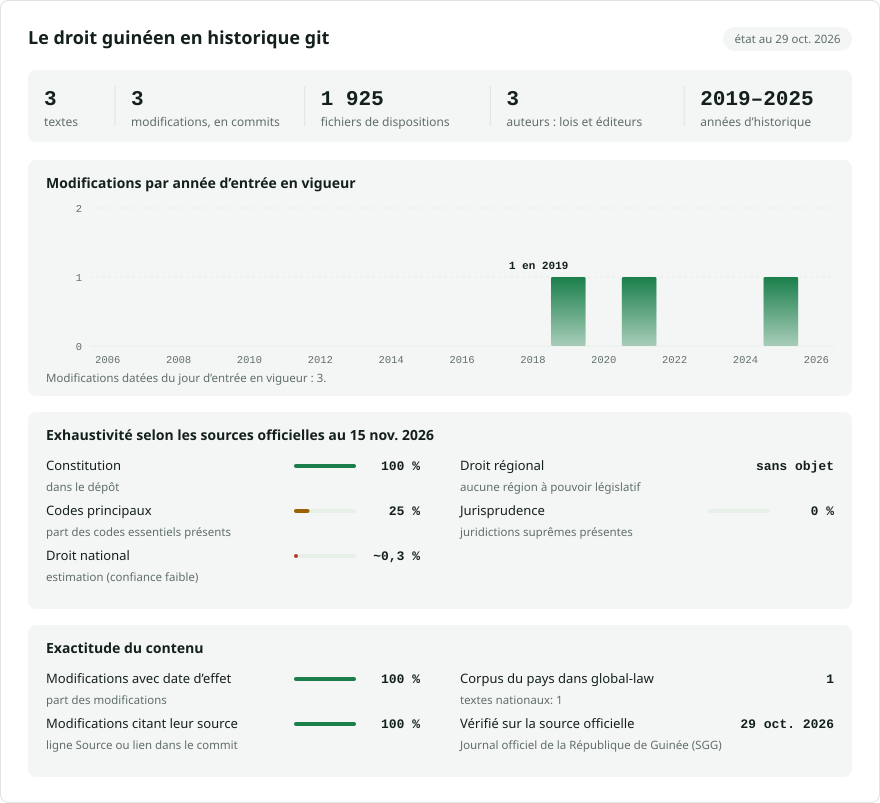

# Guinée : l’historique du droit dans git

**Français** · [English](README.en.md)

<picture>
<source media="(prefers-color-scheme: dark)" srcset="data/fr/effort-dark.svg">

</picture>

Le droit de la République de Guinée sous forme d’historique git : un fichier par disposition, chaque version enregistrée au jour de son entrée en vigueur, et pour auteur de chaque commit la loi qui a apporté la modification. `git blame` désigne la loi à l’origine de chaque alinéa ; `git log` énumère toutes les modifications d’un article ; le choix d’une date donne le texte en vigueur ce jour-là.

Fait partie de [lexifina/global-law](https://github.com/lexifina/global-law), un historique git unique pour le droit de chaque pays : ce dépôt contient le droit national guinéen, que global-law lit dans `guinea/national/acts/`.

**Contenu actuel :** trois textes, en une version chacun : la Constitution adoptée par le référendum du 21 septembre 2025 (le préambule et 199 articles), la Charte de la Transition du 27 septembre 2021 (le préambule et 84 articles) et le Code civil, loi L/2019/035/AN du 4 juillet 2019 (1 636 articles). Le `README.md` du dossier de chaque texte en énumère chaque disposition.

**Pourquoi une seule version de chaque texte.** Le Journal officiel publie chaque numéro en PDF, sans version consolidée ni datée ; un historique se reconstitue donc en appliquant successivement chaque loi modificative. Aucune loi modifiant l’un des trois textes n’a été trouvée ; chacun figure donc dans sa rédaction telle qu’adoptée.

Chaque texte a son propre dossier de fichiers d’articles : `constitution/`, `charte-de-la-transition/` et `code-civil/` (`constitution/art-044.md` est l’article 44 de la Constitution, relatif à la durée du mandat du Président de la République ; `code-civil/art-0001.md` est l’article 1er du Code civil). Les préambules de la Constitution et de la Charte figurent dans `preambule.md`, et [`code-civil/plan.md`](code-civil/plan.md) énumère les intitulés du Code civil, chacun avec le premier article qui le suit.

Le texte est en français, tel que l’imprime le Journal officiel. Une traduction anglaise ne fait pas partie de ce registre.

## Questions sous forme de commandes git

| Question | Commande |
| --- | --- |
| Toutes les modifications de l’article 44 de la Constitution (le mandat du Président) | `git log -p --word-diff -- constitution/art-044.md` |
| Quelle loi a écrit chaque ligne de l’article 44 ? | `git blame constitution/art-044.md` |
| Toutes les versions de l’article 44, avec le jour d’entrée en vigueur de chacune | `git log --format="%h %(trailers:key=In-force,valueonly,separator=) %an" -- constitution/art-044.md` |
| L’article 44 tel qu’en vigueur le 1er janvier 2026 | `python tools/en_vigueur_au.py 2026-01-01 constitution 44` |

**En dehors de git**, nous hébergeons aussi ce registre publiquement, gratuitement :

- **[Interroger Claude sur le droit guinéen](https://global-law.lexifina.com/v1/try_claude?country=guinea)** : ouvre Claude avec une première question prête.
- **[Interroger ChatGPT](https://global-law.lexifina.com/v1/try_chatgpt?country=guinea)** : la même question dans ChatGPT.
- **[Rechercher dans le droit guinéen sur notre site](https://lexifina.com/law?country=guinea&q=droit+de+gr%C3%A8ve)** : une recherche de « droit de grève », avec le texte de chaque disposition et ses versions, sans compte.
- **[API REST pour les développeurs](https://global-law.lexifina.com/v1/search_law?query=droit+de+gr%C3%A8ve&jurisdiction=guinea)** : la même recherche en JSON, sans clé. Voir la [documentation ici](https://lexifina.com/api/global-law).

Les deux assistants lisent le registre au moyen du connecteur gratuit Global law (MCP, `https://global-law.lexifina.com/mcp`) ; la première fois, la conversation vous donne le lien qui l’ajoute. Posez vos questions en français ou en anglais.

**L’héberger vous-même, simplement.** Il suffit de git et de Python, et les outils s’exécutent sur votre machine :

```sh
git clone --depth 1 https://github.com/lexifina/global-law && cd global-law
python3 tools/countries.py add guinea/national/acts
python3 tools/law.py show 2026-01-01 guinea/national/acts/constitution/art-044.md
```

Ouvert dans Claude Code, Cursor, VS Code ou Codex, le clone lance aussi un serveur MCP local doté des mêmes outils ([MCP.md](https://github.com/lexifina/global-law/blob/main/MCP.md)).

## Dates

Chaque commit est daté à midi, heure de Conakry (Africa/Conakry, UTC), du jour où la version est entrée en vigueur, et porte ce jour dans son trailer `In-force:`. Chaque texte fixe lui-même ce jour :

- la Constitution « entre en vigueur à compter de sa date de promulgation » (art. 199) : le 26 septembre 2025, par le décret D/2025/176/PRG/CNRD/SGG (Journal officiel n° 2025-12, numéro spécial 3) ;
- la Charte « prend effet à partir de sa date de signature » (art. 84) : le 27 septembre 2021 (Journal officiel n° 2021-11, pages 532 à 536) ;
- le Code civil « prend effet à compter de la date de sa promulgation » (art. 1636) : le 26 juillet 2019, par le décret D/2019/222/PRG/SGG, par dérogation à son propre art. 1er (les lois sont obligatoires à compter du lendemain de leur publication).

Chaque commit est attribué au texte lui-même, tel qu’adopté (`git log --author` nomme des lois) ; le committer est toujours Lexifina.

## Comment il est vérifié

- `tools/check_repo.py` relit chaque version depuis git au jour de son entrée en vigueur et la veille, et les deux doivent correspondre au corpus à partir duquel l’historique a été construit ; il vérifie aussi que les trailers de chaque commit se lisent sans erreur, qu’il n’existe aucun commit de fusion et qu’aucun commit n’est daté dans le futur. Les résultats figurent dans [`REPRODUCE.md`](REPRODUCE.md).
- Les termes de la Constitution et de la Charte ont été comparés avec une extraction indépendante des mêmes pages (`pdftotext` de poppler) : chaque mot du corps du texte figure dans un fichier de disposition, et aucun n’a été ajouté. Chaque caractère de la couche texte du Code civil figure dans exactement un fichier, dans l’ordre d’impression. Les PDF sont nativement numériques ; rien n’a donc été lu par OCR.
- La Charte concorde mot pour mot avec la copie HTML que publie le site même du Journal officiel, à l’exception des intitulés et de quelques erreurs ; ce registre conserve les termes imprimés (`tools/verify.py`).
- Les numéros du Journal officiel dotés d’une couche texte, jusqu’au n° 2026-12 spécial du 27 octobre 2026, ont été examinés : ceux postérieurs à la Constitution, à la recherche d’une modification de celle-ci ou de la Charte (`tools/verify.py`), et ceux publiés depuis juillet 2019, à la recherche d’une loi modifiant le Code civil (`tools/scan.py`) ; aucune n’a été trouvée.

## Ce qu’il ne montre pas

- **Les numéros qui n’ont pas pu être examinés.** Trente numéros répertoriés de juillet 2019 à 2022 sont des numérisations en image, et un numéro répertorié (2025-11 spécial n° 2) renvoie une erreur ; une modification publiée uniquement dans ces numéros échapperait à l’examen.
- **La fin de la Charte.** L’article 196 de la Constitution maintient les organes de la Transition jusqu’à l’installation des nouvelles institutions ; aucun texte du Journal officiel ne date cette installation, de sorte que la Charte n’a pas de commit de clôture et apparaît toujours comme en vigueur.
- **Les constitutions antérieures** (dont celles de 2010 et de 2020 ; les numéros de 2020 sont des numérisations), ainsi que les autres codes et lois.
- **Les intitulés** de la Constitution et de la Charte sont omis (chaque fichier commence par « # Article N ») ; ceux du Code civil figurent dans `plan.md`. Les décrets de promulgation et les lignes de signature sont omis.
- **Les textes publiés uniquement sous forme d’images numérisées** : pas d’OCR.

## Sources

| Source | Nature | Versions antérieures | Remarques |
| --- | --- | --- | --- |
| [Journal officiel de la République de Guinée](https://journal-officiel.sgg.gov.gn) (Secrétariat général du Gouvernement) | Journal officiel, un PDF par numéro | non | La Constitution (n° 2025-12, numéro spécial 3) et la Charte (n° 2021-11) ; tous les numéros ultérieurs examinés à la recherche de modifications |
| [Codes en vigueur](https://journal-officiel.sgg.gov.gn/fr/textes-officiels/les-codes-consolides.html) (même site) | Les codes en vigueur, sous forme de numéros du Journal officiel | non | Le Code civil : numéro spécial du Journal officiel d’août 2019, pages 02 à 85 |

## Licence

Voir [`LICENSE`](LICENSE). Les textes sont des textes juridiques officiels de la République de Guinée, tirés du Journal officiel de la République de Guinée (Secrétariat général du Gouvernement) et reproduits avec cette mention de source ; le Journal officiel ne publie aucune licence pour ces textes, et leur statut au regard du droit d’auteur n’est pas confirmé. Les contributions propres de Lexifina (l’agencement, les messages de commit, les tableaux et les outils) sont sous CC0 1.0.

Aucun modèle d’IA n’a écrit, traduit ou corrigé de texte juridique, et aucun n’est exécuté lors de la construction de l’historique ; les scripts ont été écrits par Claude Code utilisant Claude Opus 5.5 (voir [`REPRODUCE.md`](REPRODUCE.md)).

Ceci est une traduction de la version anglaise ([README.en.md](README.en.md)) ; en cas de divergence, la version anglaise fait foi.

## En savoir plus

Dans le dépôt [lexifina/global-law](https://github.com/lexifina/global-law) (pages en anglais) :

- [FEATURES.md](https://github.com/lexifina/global-law/blob/main/FEATURES.md): toutes les fonctionnalités et ce que chaque corpus doit prendre en charge (`git blame`, `law.py`, outils MCP)
- [FAQ.md](https://github.com/lexifina/global-law/blob/main/FAQ.md): questions et réponses · [CONTRIBUTING.md](https://github.com/lexifina/global-law/blob/main/CONTRIBUTING.md): proposer une modification · [MCP.md](https://github.com/lexifina/global-law/blob/main/MCP.md): serveur MCP · [REPRODUCE.md](https://github.com/lexifina/global-law/blob/main/REPRODUCE.md): comment il a été construit · [CHANGELOG.md](https://github.com/lexifina/global-law/blob/main/CHANGELOG.md)
- [FRESHNESS.md](https://github.com/lexifina/global-law/blob/main/FRESHNESS.md): à quel point chaque corpus est à jour · [Surveillance](https://github.com/lexifina/global-law/tree/main/monitoring): si les mises à jour fonctionnent · [WATCHING.md](https://github.com/lexifina/global-law/blob/main/WATCHING.md): comment chaque source officielle est surveillée pour repérer les modifications
- [performance/](https://github.com/lexifina/global-law/tree/main/performance): la rapidité des outils, mesurée
- [visualisations/](https://github.com/lexifina/global-law/tree/main/visualisations): graphiques et liens à travers le droit du monde entier
- [Vulnérabilités](https://github.com/lexifina/global-law/tree/main/vulnerabilities): erreurs dans les textes tels qu’ils ont été publiés
